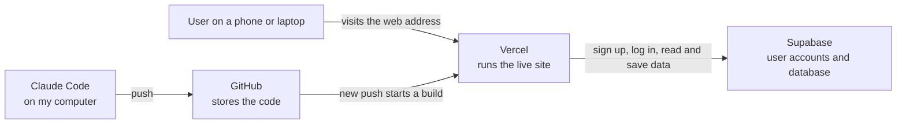
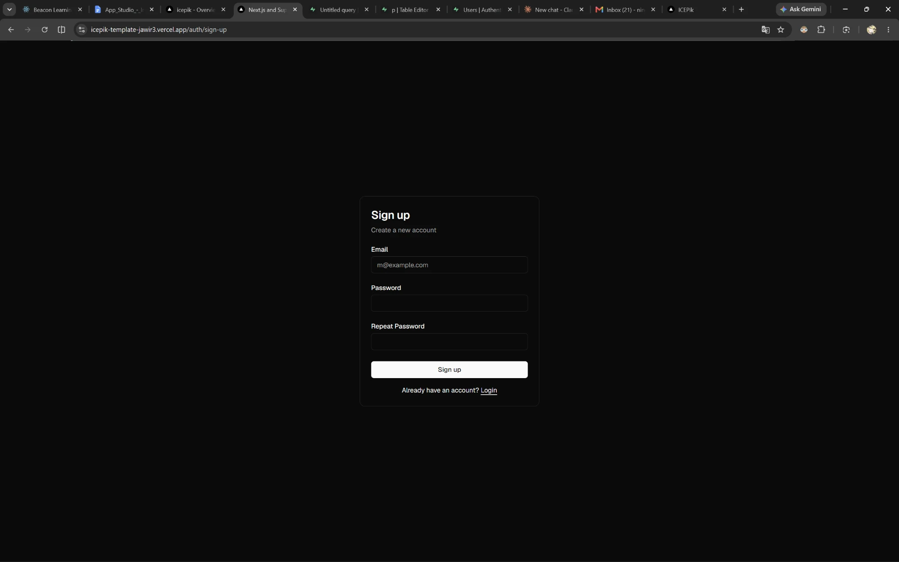
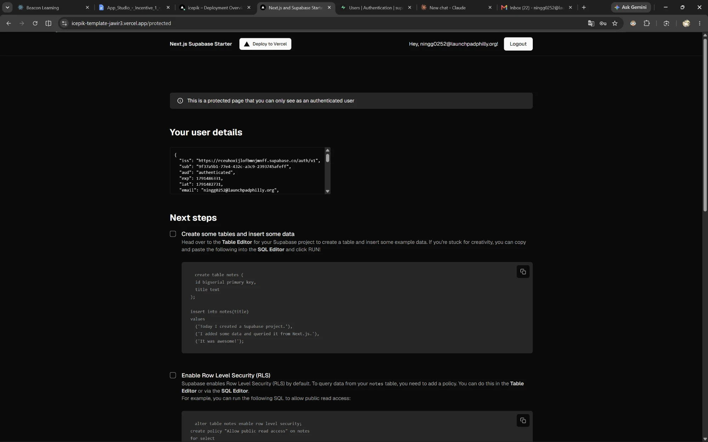
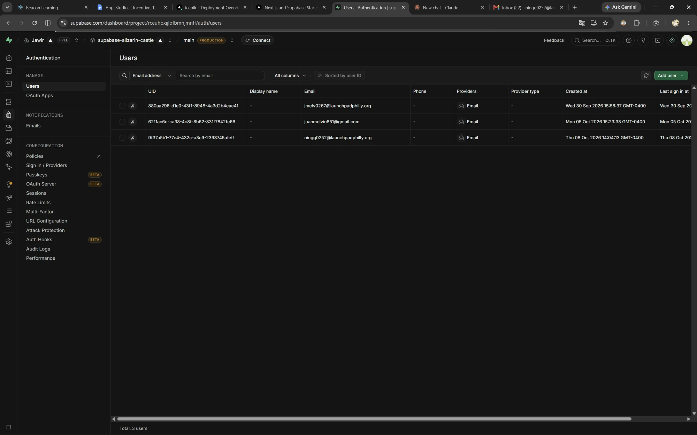
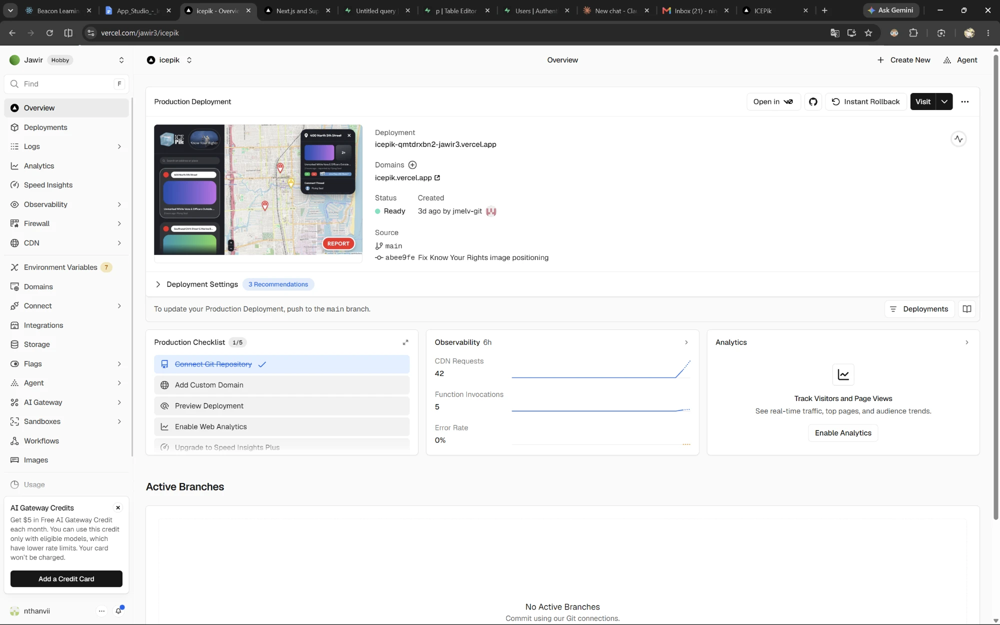
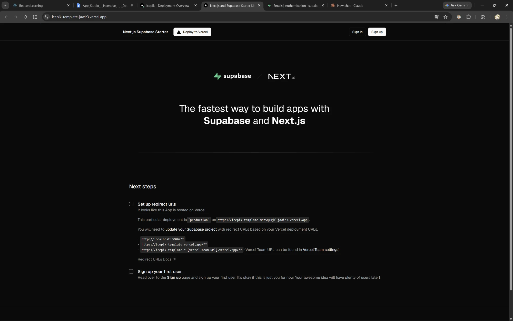
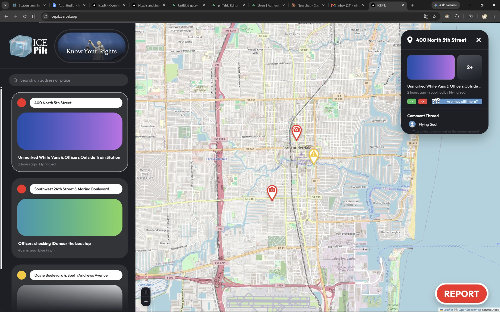

# ICEPik

ICEPik is a map where immigrants in Philadelphia can view ICE sightings and report them anonymously. Other users can then help verify each report. We're building it because ICE alerts spread through family group chats today, and as one person we interviewed put it, "The group chat is fast, but it can't tell you if what someone saw is real."

**Live site:** https://icepik.vercel.app

---

## 1. Where does the code live?

On GitHub, in [nthanvii/icepik](https://github.com/nthanvii/icepik). Vercel deploys the live site from this repo's `main` branch. Juan works in a fork, [jmelv-git/icepik](https://github.com/jmelv-git/icepik), and sends changes back as pull requests. `main` on nthanvii/icepik is always the latest version.

It started as Vercel's Next.js and Supabase starter. We then used Claude Code to build our design mockup on top of it: a map, report cards, a report detail card and a "Know Your Rights" pop-up.

## 2. Where does the data live, and what is stored there right now?

Everything is in Supabase, a database with user accounts built in. The tables and their access rules are in `database/icepik_schema.sql`, and `docs/database-handoff.md` explains them and the Supabase settings they need.

- **Accounts:** everyone gets an anonymous account when they first agree to the terms, with no name, email or phone number. Saving it adds a username and password. Supabase stores passwords in a scrambled form, so nobody can read them, including us. The three email accounts the team made while testing the starter are still there too.
- **Sightings:** each pin's location (rounded to about 100 m), street label, category, counts, description, times, and confirmation and dispute totals. Everyone can see a pin while it's on the map, at least 4 hours. Expired pins stay in the database so we can measure how accurate reports are, but the app can't read them.
- **Who posted or voted on a sighting:** kept in two private tables that only that person can read, and deleted within an hour after the pin expires.
- **Profiles:** each account's language setting, and how many sightings it has posted and votes it has cast in total.

Home and work places stay in the browser and never reach the database. The map pictures and the address search come from OpenStreetMap, and we don't store anything from them.

The site needs these environment variables, in Vercel and in `.env.local` for `npm run dev`:

| Variable | What it is |
| --- | --- |
| `NEXT_PUBLIC_SUPABASE_URL` | The Supabase project's URL. |
| `NEXT_PUBLIC_SUPABASE_PUBLISHABLE_KEY` | The project's publishable key. The older `NEXT_PUBLIC_SUPABASE_ANON_KEY` works too. Never use the secret or `service_role` key. |
| `NEXT_PUBLIC_TURNSTILE_SITE_KEY` | Optional. The Cloudflare Turnstile site key, needed only when CAPTCHA is on in Supabase. |

## 3. How does a change get from Claude Code to the live site?

1. We ask Claude Code to make a change in the code.
2. We check it at `localhost:3000` by running `npm run dev`.
3. We commit the change and push it to GitHub.
4. Vercel sees the new commit on `main` and starts a new build on its own.
5. After about a minute the build shows **Ready** in Vercel, and the change is live at https://icepik.vercel.app.

## 4. What will we need to add to turn this into our team's app?

We'd need to add these things to make a production-ready build:

- **Optional accounts:** people must be able to view and report sightings without an account, so they never have to give us their email.
- **Philadelphia:** move the map and the sample reports from Fort Lauderdale, where the mockup's map was, to Philadelphia.
- **Saved reports:** a reports table in Supabase with the location, a description, the time, and whether the sighting is *suspected* (yellow pin) or *confirmed* (red camera pin). It won't store who sent the report.
- **Photos and videos:** a place to store them (Supabase Storage). A confirmed report needs one. Before storing a photo, we remove the hidden data inside it that can show where it was taken and on what phone.
- **Votes:** a votes table, so people can mark a sighting as real or not real.
- **Comments:** a comments table, linked to each report.
- **Usability:**
  - a short tutorial and a language choice on the first visit;
  - a translate button;
  - a legend that explains the pin colors;
  - an "Are they still there?" button that works.
- **Nearby alerts:** notifications limited to a small area around you. One complaint about the Citizen app was getting alerts from the other side of the country.

The "Know Your Rights" pop-up with links to legal resources is already built.

## 5. Diagram

---

## Screenshots

**Sign-up page on the live site, with the web address showing**

**The page we see after logging in**

**Our users in Supabase, under Authentication > Users**

**Vercel showing the deployment is Ready**

**Before our Claude Code changes:** the site was the Next.js Supabase Starter.

**After:** it's the ICEPik map, at https://icepik.vercel.app.

---

## License

MIT. See [LICENSE](LICENSE).
