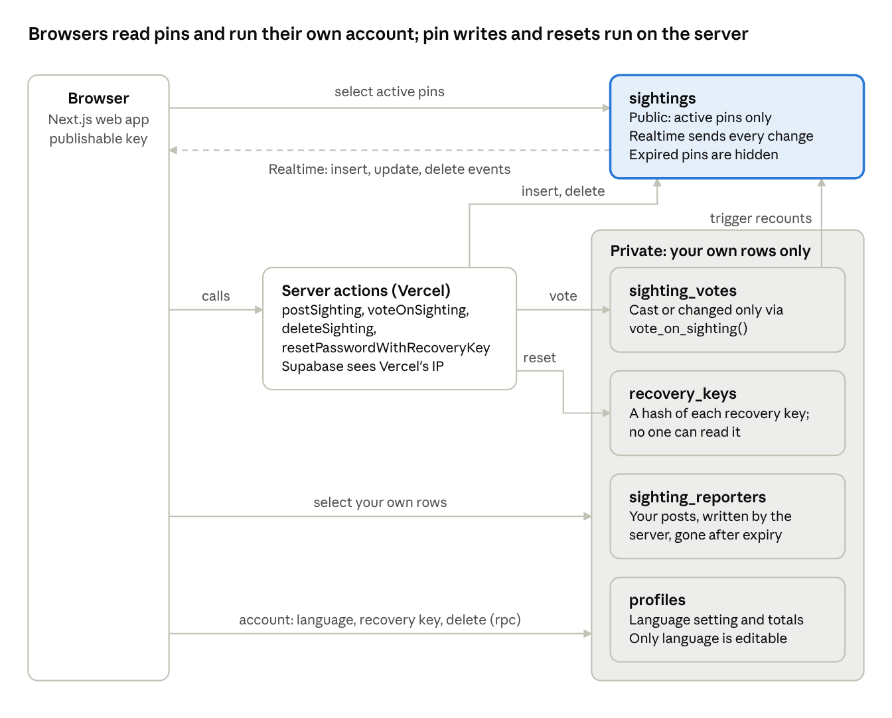

# ICEPik Database Handoff

Nov 16, 2026 · @Juan

## Overview

The ICEPik backend is ready for the MVP: a Supabase Postgres database with five tables, the database functions the app and its server actions call, and a live feed of map pins. Browsers read pins and manage their own account with supabase-js and the publishable key; posting, voting, deleting a pin and password resets go through Next.js server actions. The server enforces every rule, so the app can't break them by accident.

**The one rule everything follows:** nothing another user can read may connect a person to a place. Pins are public. Who posted or voted on a pin is private to that person, and those records are deleted within an hour after the pin expires. The section "What we need from you" lists how the app keeps this rule too.

- Handoff package: `icepik-handoff.zip` holds every file below, a PDF of this doc and a README.
- Schema: `icepik_schema.sql`, run once in Supabase's SQL Editor.
- Upgrade a project that already has data: `database/migrations/20261116_recovery_keys.sql`. It adds the recovery-key parts and replaces delete\_my\_account(), and keeps every pin, vote and account. Follow the order under "Existing project".
- Live checks for a scratch Supabase project: `scripts/supabase-live-checks.mjs`.
- Server code: `lib/supabase/server.ts`, `lib/supabase/admin.ts`, `app/actions/sightings.ts` and `app/actions/recovery.ts`, also printed under "How to call it".
- Diagram, access rules and copyable SQL: [ICEPik Database Map](https://claude.ai/artifact/8dMTG4gPJUmLJvZ2vKpZaS), or `icepik-database-map.html` in the package.
- **Frontend:** The setup code assumes Next.js on Vercel.

## Before you start

Confirm these eight Supabase settings with the backend owner, then set up the client. The browser uses only the project URL and the publishable key. The secret key (sb\_secret\_…) stays on the server for the password reset; the older service\_role key isn't used.

| Setting (Authentication section) | Value | Why |
| --- | --- | --- |
| Sign In / Providers → Allow anonymous sign-ins | On | The app creates an account silently once the user accepts the terms |
| Sign In / Providers → Email → Confirm email | Off | Lets users save a username and password without an inbox |
| Attack Protection → CAPTCHA | On (required) | Guards account creation, password sign-in and Supabase's own password reset against throwaway accounts and username checks. The app sends a `captchaToken` with each of those calls. Put the Turnstile site key in the app's build before turning CAPTCHA on, or every sign-in fails |
| Audit Logs → Write audit logs to the database | Off | Otherwise every sign-in's IP address is also copied into the database. Each session's latest IP still stays in auth.sessions (see the known gaps) |
| Hooks → Send Email → Postgres function block\_auth\_emails | On | Supabase never creates an emailed reset or sign-in code, so there is no hidden code to guess for a known username |
| Sign In / Providers → Email → Secure password change | Off | It emails a code to the account's address, which can never arrive; saving an account would fail once a session is a day old |
| Sign In / Providers → Email → Minimum password length | 15 | NIST's minimum when the password is an account's only protection |
| Sign In / Providers → Email → Require current password when changing password | On | Someone holding an unlocked phone can't change the password without knowing it |

**Secret key.** The password reset needs Supabase's secret key (`sb_secret_…`; the older service\_role keys are being retired at the end of 2026). Add it in Vercel as `SUPABASE_SECRET_KEY` to the **Production** environment only, with **Sensitive** turned on: never to Preview or Development or a developer's .env.local (use a scratch project's keys to try the reset locally), and never with a `NEXT_PUBLIC_` name. Only `lib/supabase/admin.ts` reads it; on a deployment without it, the reset answers that it isn't available. The key skips every database rule, so a leak would expose the private links between people and pins, and every account. If it leaks, make a new secret key in Supabase and delete the old one.

**Existing project.** The live project already has data, so upgrade it with `database/migrations/20261116_recovery_keys.sql`, never the whole schema or its "Starting over" lines, which delete every pin, vote and profile total. The file's header has the steps; do them in this order. (0) Run `scripts/supabase-live-checks.mjs` on a scratch project, and stop unless every check passes. (1) Deploy the app version that ships with the migration, with `NEXT_PUBLIC_TURNSTILE_SITE_KEY` set, and check that the Turnstile check appears: its "Delete my account" asks a saved account for its password, which the migration starts to require, and it works with the old database too. (2) Count the saved accounts whose login ID breaks the username rule, and delete or rename them: once the migration has run they can be deleted but no longer renamed. The app can't log them in, delete them or reset their password. (3) Run the migration. (4) Turn on the settings above, CAPTCHA only once the site key is live. (5) Open the site in a private window, accept the terms, and check that a new anonymous user appears.

**Client.** Set up supabase-js with `@supabase/ssr`, the way Supabase's [Next.js guide](https://supabase.com/docs/guides/auth/server-side/nextjs) does: `createBrowserClient` in client components, and `createServerClient` with cookies in server code and middleware. The saved session *is* the anonymous account: if its cookie isn't kept, the user loses their account and their posts.

```ts
// lib/supabase/client.ts
import { createBrowserClient } from '@supabase/ssr'
import type { Database } from '@/database.types'

export const createClient = () =>
  createBrowserClient<Database>(
    process.env.NEXT_PUBLIC_SUPABASE_URL!,
    process.env.NEXT_PUBLIC_SUPABASE_PUBLISHABLE_KEY!,
  )
```

**Types.** Generate TypeScript types once the schema is in place, and again after any schema change.

```bash
npx supabase gen types typescript --project-id <project-ref> > database.types.ts
```

**Test pins.** Seed pins from the SQL Editor. They have no reporter, so anyone can vote on them, and they expire after 4 hours like real pins. Delete them before measuring the success metrics.

```sql
insert into public.sightings (lat, lng, category, agent_count, vehicle_count, location_label, description)
values (39.970, -75.160, 'vehicle', 2, 1, 'Broad St & Girard Ave', 'TEST'),
       (39.953, -75.165, 'checkpoint', 4, 2, 'Broad St & Market St', 'TEST');

-- when you're done testing
delete from public.sightings where description = 'TEST';
```

## Data model

The app works with four tables; a fifth, recovery\_keys, is reached only through database functions. Only `sightings` is public, and only while a pin is active; the other three return just the signed-in user's own rows.



Browsers read pins, receive live updates and manage their own account (language, recovery key, saving or deleting it). Posting, voting, deleting a pin and password resets run as server actions on Vercel, so those requests reach Supabase from Vercel's IP address instead of the user's. The private tables return only the signed-in user's own rows, and recovery\_keys returns nothing at all.

### sightings (public)

| Column | Type | Notes |
| --- | --- | --- |
| `id` | uuid | Primary key |
| `lat`, `lng` | number | Rounded to 3 decimals (about 100 m) when saved |
| `location_label` | text, up to 120 characters, optional | Street names only; a leading house number is removed |
| `category` | `patrol`, `vehicle`, `checkpoint`, `raid` or `other` | Defaults to `other` |
| `agent_count`, `vehicle_count` | whole number 0–99, optional | Empty means "not sure" |
| `description` | text, up to 280 characters, optional | Public and not moderated |
| `created_at` | timestamp | Set by the server |
| `expires_at` | timestamp | Posting time + 4 hours; a person's first vote, if it's a confirmation, extends it |
| `confirm_count`, `dispute_count` | whole number | Read only; kept current by the server |
| `verification_score` | number 0.00–1.00 | Read only; 0.50 before any votes |
| `verification_status` | `verified`, `disputed` or `unverified` | Read only |

The app reads active pins (signed in or not) and inserts new ones. It deletes its own active pins through `delete_my_sighting()`. Nobody can edit a pin after posting it.

### Private tables

| Table | Columns | What the app can do |
| --- | --- | --- |
| `sighting_votes` | `sighting_id`, `voter_id`, `vote` (`confirm` or `dispute`), `created_at` | Read your own votes. Cast or change a vote only through `vote_on_sighting()` |
| `sighting_reporters` | `sighting_id`, `reporter_id` | Read your own rows to list "my posts". The server writes them and deletes them after the pin expires |
| `profiles` | `id` (the user's id), `preferred_language`, `sightings_posted`, `votes_cast`, `post_limit_hour`, `post_limit_count`, `created_at` | Read your own profile. Change `preferred_language` only through `set_my_language()` |
| `recovery_keys` | `user_id`, `key_hash` (SHA-256 of the key) | Nothing: the browser roles have no grants on it and there are no row policies. Only the recovery-key functions read or write it |

### Server functions

| Call | Who | What it does |
| --- | --- | --- |
| `sightings_near(pin_lat, pin_lng, radius_m = 1609)` | Anyone | Active pins within `radius_m` meters, nearest first, each with `distance_m`. Only for a pin dropped on the map, never home or work |
| `vote_on_sighting(target_sighting_id, my_vote, my_lat, my_lng)` | Signed in | Called by the voteOnSighting server action. Confirms or disputes after checking the voter is within 1 km; returns the updated pin |
| `delete_my_sighting(target_sighting_id)` | Signed in | Called by the deleteSighting server action. Deletes your own active pin |
| `set_my_language(new_language)` | Signed in | Changes your language setting |
| `delete_my_account()` | Signed in | Deletes the account and its private records; its pins stay on the map. A saved account needs a password sign-in in the last 10 minutes, from a session that still exists |
| `create_recovery_key()` | Saved accounts, within 10 minutes of a password sign-in, from a session that still exists | Creates or replaces your recovery key and returns it once; any older key stops working |
| `has_recovery_key()` | Signed in | Whether you have a recovery key; ask a saved account without one to make one |
| `check_recovery_key(p_username, p_key)` | Server only (secret key) | The account id when the username and key match, otherwise nothing |
| `replace_recovery_key(p_user_id)` | Server only (secret key) | Gives the account a new key after a reset and returns it once |

## How to call it

Reads and live updates use supabase-js in the browser. Posting, voting and deleting a pin go through Next.js server actions, so Supabase logs Vercel's IP for them instead of the user's (it still logs the user id; see the known gaps). Errors come back as plain messages ready to show (see "Errors to handle").

### Server actions (copy these four files)

`lib/supabase/server.ts` is Supabase's official server client for Next.js. `lib/supabase/admin.ts` is the only client that holds the secret key, and only the password reset uses it. `app/actions/sightings.ts` holds posting, voting and deleting; `app/actions/recovery.ts` holds the password reset. All of them import the generated types from `database.types.ts` at the project root; change that path if yours differs. They pass a type-check against Next.js 16.4, `@supabase/ssr` 0.12 and `@supabase/supabase-js` 2.118, plus tests that call them with missing, wrong-type and oversized input. Run `npm install server-only` for the guard at the top of both `lib` files.

```ts
// lib/supabase/server.ts
import 'server-only'
import { createServerClient } from '@supabase/ssr'
import { cookies } from 'next/headers'
import type { Database } from '@/database.types'

/**
 * Supabase client for server code (server actions, route handlers).
 * Same as Supabase's official Next.js example, plus the generated types.
 *
 * Don't put this client in a global variable. Create a new one inside each
 * function that uses it.
 */
export async function createClient() {
  const cookieStore = await cookies()

  return createServerClient<Database>(
    process.env.NEXT_PUBLIC_SUPABASE_URL!,
    process.env.NEXT_PUBLIC_SUPABASE_PUBLISHABLE_KEY!,
    {
      cookies: {
        getAll() {
          return cookieStore.getAll()
        },
        setAll(cookiesToSet) {
          try {
            cookiesToSet.forEach(({ name, value, options }) =>
              cookieStore.set(name, value, options),
            )
          } catch {
            // Called from a Server Component, which can't set cookies.
            // Safe to ignore while proxy.ts (middleware.ts before Next.js 16)
            // refreshes user sessions.
          }
        },
      },
    },
  )
}
```

```ts
// app/actions/sightings.ts
'use server'

// Posting, voting and deleting run here, on Vercel, instead of in the browser.
// Supabase then logs Vercel's IP address for these requests instead of the
// user's. Its logs still record the user id from the session token, so while
// it keeps them they can match these requests to the same user's browser
// requests, which do carry their IP. See the known gaps in the handoff doc.
//
// Rules for this file:
// - Anyone can call these actions directly with any input, not just through
//   our UI. TypeScript types aren't checked at runtime, so every argument is
//   checked here before it reaches the database.
// - Build each database row field by field. Never pass client input straight
//   into a query, or callers could set fields they shouldn't.
// - Never accept a user id from the caller. The database takes the user from
//   the session cookie.
// - Never console.log the input. Vercel keeps runtime logs, and the input holds
//   coordinates and pin ids.
// - Return errors as values. Next.js hides the message of a thrown error in
//   production, and the database's messages are already written for users.
//
// Usage from a client component:
//   const result = await voteOnSighting({ sightingId, vote: 'confirm', myLat, myLng })
//   if (!result.ok) showMessage(result.message)

import type { PostgrestError } from '@supabase/supabase-js'
import { createClient } from '@/lib/supabase/server'
import type { Database } from '@/database.types'

type Sighting = Database['public']['Tables']['sightings']['Row']
type Category = Database['public']['Enums']['sighting_category']
type Vote = Database['public']['Enums']['vote_type']

export type ActionResult<T> = { ok: true; data: T } | { ok: false; message: string }

export type NewSighting = {
  lat: number
  lng: number
  category: Category
  agentCount?: number | null
  vehicleCount?: number | null
  locationLabel?: string | null
  description?: string | null
}

const CATEGORIES: readonly Category[] = ['patrol', 'vehicle', 'checkpoint', 'raid', 'other']
const VOTES: readonly Vote[] = ['confirm', 'dispute']
const UUID = /^[0-9a-f]{8}-[0-9a-f]{4}-[0-9a-f]{4}-[0-9a-f]{4}-[0-9a-f]{12}$/i
const TRY_AGAIN = 'Something went wrong. Please try again.'

export async function postSighting(input: NewSighting): Promise<ActionResult<Sighting>> {
  const problem = checkNewSighting(input)
  if (problem) return { ok: false, message: problem }

  const supabase = await createClient()
  const { data, error } = await supabase
    .from('sightings')
    .insert({
      lat: input.lat,
      lng: input.lng,
      category: input.category,
      agent_count: input.agentCount ?? null,
      vehicle_count: input.vehicleCount ?? null,
      location_label: input.locationLabel?.trim() || null,
      description: input.description?.trim() || null,
    })
    .select()
    .single()

  return error ? failure(error) : { ok: true, data }
}

export async function voteOnSighting(input: {
  sightingId: string
  vote: Vote
  myLat: number
  myLng: number
}): Promise<ActionResult<Sighting>> {
  if (!isRecord(input)) return { ok: false, message: TRY_AGAIN }
  if (!isInRange(input.myLat, -90, 90) || !isInRange(input.myLng, -180, 180)) {
    return { ok: false, message: 'Turn on location to confirm or dispute a sighting.' }
  }
  if (!UUID.test(String(input.sightingId)) || !VOTES.includes(input.vote)) {
    return { ok: false, message: TRY_AGAIN }
  }

  const supabase = await createClient()
  const { data, error } = await supabase.rpc('vote_on_sighting', {
    target_sighting_id: input.sightingId,
    my_vote: input.vote,
    my_lat: input.myLat,
    my_lng: input.myLng,
  })

  return error ? failure(error) : { ok: true, data }
}

export async function deleteSighting(sightingId: string): Promise<ActionResult<null>> {
  if (!UUID.test(String(sightingId))) return { ok: false, message: TRY_AGAIN }

  const supabase = await createClient()
  const { error } = await supabase.rpc('delete_my_sighting', { target_sighting_id: sightingId })

  return error ? failure(error) : { ok: true, data: null }
}

// Server actions are public endpoints, so check the input even though the
// database enforces the same rules.
function checkNewSighting(input: unknown): string | null {
  if (!isRecord(input)) return TRY_AGAIN
  if (!isInRange(input.lat, -90, 90) || !isInRange(input.lng, -180, 180)) {
    return 'Pick a spot on the map first.'
  }
  if (!CATEGORIES.includes(input.category as Category)) return 'Choose what you saw.'
  if (!isCount(input.agentCount) || !isCount(input.vehicleCount)) {
    return 'Counts must be whole numbers from 0 to 99.'
  }
  if (!isOptionalText(input.locationLabel, 120)) return 'Keep the location under 120 characters.'
  if (!isOptionalText(input.description, 280)) return 'Keep the description under 280 characters.'
  return null
}

function isRecord(value: unknown): value is Record<string, unknown> {
  return typeof value === 'object' && value !== null && !Array.isArray(value)
}

function isOptionalText(value: unknown, maxLength: number): boolean {
  return value == null || (typeof value === 'string' && value.length <= maxLength)
}

function isInRange(value: unknown, min: number, max: number): value is number {
  return typeof value === 'number' && Number.isFinite(value) && value >= min && value <= max
}

function isCount(value: unknown): boolean {
  return value == null || (Number.isInteger(value) && isInRange(value, 0, 99))
}

function failure(error: PostgrestError): ActionResult<never> {
  // P0001 = a message from ICEPik's own database checks, written for users.
  if (error.code === 'P0001') return { ok: false, message: error.message }
  // 42501 = no session: the function's permission check or row-level
  // security refused it, usually because the session cookie expired.
  if (error.code === '42501') {
    return { ok: false, message: 'Your session has expired. Reload the page and try again.' }
  }
  return { ok: false, message: TRY_AGAIN }
}
```

```ts
// lib/supabase/admin.ts
import 'server-only'
import { createClient } from '@supabase/supabase-js'
import type { Database } from '@/database.types'

/**
 * Supabase client with the SECRET key. It skips every database rule, so it is
 * used in exactly one place: the password reset in app/actions/recovery.ts.
 * Never import it anywhere else, and never give the key a NEXT_PUBLIC_ name.
 *
 * SUPABASE_SECRET_KEY is set in Vercel's Production environment only, marked
 * Sensitive. Preview deployments don't get it, so there this returns null and
 * the reset says it isn't available.
 */
export function createAdminClient() {
  const url = process.env.NEXT_PUBLIC_SUPABASE_URL
  const secretKey = process.env.SUPABASE_SECRET_KEY
  if (!url || !secretKey) return null
  return createClient<Database>(url, secretKey, {
    auth: { persistSession: false, autoRefreshToken: false },
  })
}
```

```ts
// app/actions/recovery.ts
'use server'

// "Forgot password?" for saved accounts, using the recovery key shown when the
// account was saved. No email or phone is involved.
//
// Same rules as sightings.ts: check every argument, never console.log the
// input (it holds a password and a recovery key), and return errors as values.
// This is the only action that uses the secret key (lib/supabase/admin.ts).
//
// Usage from the reset page:
//   const result = await resetPasswordWithRecoveryKey({ username, recoveryKey, newPassword })
//   if (result.ok) showNewKeyOnce(result.data.newRecoveryKey), then sign in with the
//   new password (with a fresh CAPTCHA token: each token works only once)

import { createAdminClient } from '@/lib/supabase/admin'
import type { ActionResult } from '@/app/actions/sightings'

const USERNAME = /^[a-z0-9_]{3,20}$/
// One answer for unknown usernames and wrong keys.
const NO_MATCH = "That username and recovery key don't match."
const TRY_AGAIN = 'Something went wrong. Please try again.'
const KEY_NOT_REPLACED =
  "Your password was changed, but ICEPik couldn't make your new recovery key. Reset again with the same key to get one."

export async function resetPasswordWithRecoveryKey(input: {
  username: string
  recoveryKey: string
  newPassword: string
}): Promise<ActionResult<{ newRecoveryKey: string }>> {
  if (typeof input !== 'object' || input === null || Array.isArray(input)) {
    return { ok: false, message: TRY_AGAIN }
  }
  const username = typeof input.username === 'string' ? input.username.trim().toLowerCase() : ''
  const recoveryKey = typeof input.recoveryKey === 'string' ? input.recoveryKey : ''
  const newPassword = typeof input.newPassword === 'string' ? input.newPassword : ''

  if (!USERNAME.test(username) || recoveryKey.length === 0 || recoveryKey.length > 64) {
    return { ok: false, message: NO_MATCH }
  }
  // Counted the way Supabase counts: at least 15 characters (code points), and
  // at most 72 bytes, bcrypt's limit, which Supabase refuses to go over.
  if (Array.from(newPassword).length < 15) {
    return { ok: false, message: 'Use a password of at least 15 characters. A few random words work well.' }
  }
  if (new TextEncoder().encode(newPassword).length > 72) {
    return { ok: false, message: 'That password is too long. Use up to 72 characters, fewer if it has accented letters or emoji.' }
  }

  // Only Vercel's Production environment has the secret key.
  const admin = createAdminClient()
  if (!admin) return { ok: false, message: "Password reset isn't available on this version of the site." }

  const { data: userId, error } = await admin.rpc('check_recovery_key', {
    p_username: username,
    p_key: recoveryKey,
  })
  if (error) return { ok: false, message: TRY_AGAIN }
  if (!userId) return { ok: false, message: NO_MATCH }

  // Sets the password and ends every session for this account, including on a
  // lost or seized phone. A device that's already signed in can still read and
  // post until its access token expires (the JWT expiry, 1 hour by default),
  // but it can't make a recovery key or delete the account.
  const { error: passwordError } = await admin.auth.admin.updateUserById(userId, {
    password: newPassword,
  })
  if (passwordError) {
    return {
      ok: false,
      message: passwordError.code === 'weak_password' ? 'Choose a stronger password.' : TRY_AGAIN,
    }
  }

  // Replace the used key, trying twice. The password has already changed, so
  // if both tries fail, say so: the used key still works, and resetting again
  // with it gives a new one.
  for (let attempt = 0; attempt < 2; attempt++) {
    const { data: newRecoveryKey, error: keyError } = await admin.rpc('replace_recovery_key', {
      p_user_id: userId,
    })
    if (!keyError && newRecoveryKey) return { ok: true, data: { newRecoveryKey } }
  }
  return { ok: false, message: KEY_NOT_REPLACED }
}
```

### Sign in after the user accepts the terms

```ts
const { data: { session } } = await supabase.auth.getSession()
if (!session) {
  // Only after the terms are accepted. CAPTCHA is required: send a fresh token.
  await supabase.auth.signInAnonymously({ options: { captchaToken } })
}
```

### Load the map

```ts
const { data: pins } = await supabase.from('sightings').select('*') // only active pins come back
```

### Keep the map live

```ts
supabase
  .channel('map')
  .on('postgres_changes', { event: '*', schema: 'public', table: 'sightings' }, (change) => {
    if (change.eventType === 'DELETE') removePin(change.old.id)
    else upsertPin(change.new) // INSERT or UPDATE: a new pin, new counts or a later expiry
  })
  .subscribe()
```

Pins expire without sending an event, so remove any pin whose `expires_at` has passed at least once a minute. Missed events aren't replayed: reload the pins when the app returns to the foreground or reconnects.

### Post a sighting

```ts
import { postSighting } from '@/app/actions/sightings'

const result = await postSighting({
  lat, lng, category: 'vehicle', agentCount: 3, vehicleCount: 2,
  locationLabel: 'Broad St & Girard Ave', description,
})
if (!result.ok) showMessage(result.message)
```

The database rounds the location and sets the time, expiry and counts. The new pin also reaches every open map through Realtime.

### Confirm or dispute

```ts
import { voteOnSighting } from '@/app/actions/sightings'

const result = await voteOnSighting({
  sightingId: pin.id,
  vote: 'confirm', // or 'dispute'; voting again switches it
  myLat, myLng,    // the device's current GPS fix
})
if (!result.ok) showMessage(result.message)
```

Votes can be switched but not removed.

### Check a saved place or a dropped pin

For home and work, filter the pins already on the phone, so those places never leave it. This is the same distance formula the server uses, so it also works for the 1 km vote pre-check.

```ts
const toRad = (d: number) => (d * Math.PI) / 180
export function distanceMeters(lat1: number, lng1: number, lat2: number, lng2: number) {
  const a = Math.sin(toRad(lat2 - lat1) / 2) ** 2
    + Math.cos(toRad(lat1)) * Math.cos(toRad(lat2)) * Math.sin(toRad(lng2 - lng1) / 2) ** 2
  return 2 * 6371000 * Math.asin(Math.min(1, Math.sqrt(a)))
}

const nearHome = pins.filter((p) => distanceMeters(home.lat, home.lng, p.lat, p.lng) <= 1609)
```

For a pin dropped on the map (never home or work), the server can do the search and return `distance_m` with each pin:

```ts
const { data: nearby } = await supabase.rpc('sightings_near', { pin_lat, pin_lng, radius_m: 1609 })
```

### My posts, my votes, deleting a post

```ts
import { deleteSighting } from '@/app/actions/sightings'

const { data: myPosts } = await supabase.from('sighting_reporters').select('sighting_id')
const { data: myVotes } = await supabase.from('sighting_votes').select('sighting_id, vote')
const result = await deleteSighting(pinId) // your own active pin only
```

### Settings

```ts
const { data: profile } = await supabase
  .from('profiles').select('preferred_language, sightings_posted, votes_cast').single()
await supabase.rpc('set_my_language', { new_language: 'es' })

// Change password: "Require current password" is on, so send the current one too
const { error } = await supabase.auth.updateUser({ password: newPassword, current_password: currentPassword })
if (error) showAuthError(error.code) // current_password_invalid, same_password, weak_password, …

// "Make a new recovery key": ask for the password and a fresh CAPTCHA token first.
// The database makes a key only within 10 minutes of a password sign-in, and only
// while that session exists. End the session the sign-in replaces.
const { data: { session: before } } = await supabase.auth.getSession()
const { error: signInError } = await supabase.auth.signInWithPassword({ email: before!.user.email!, password, options: { captchaToken } })
if (signInError) return showAuthError(signInError.code) // invalid_credentials → "Wrong password"
if (before) await supabase.auth.admin.signOut(before.access_token, 'local').catch(() => undefined)
const { data: newRecoveryKey, error: keyError } = await supabase.rpc('create_recovery_key') // the old key stops working
if (keyError) return showMessage(keyError.message)
```

### Save the account, log in on another device

```ts
// Usernames: 3–20 lowercase letters, numbers or underscores. The database refuses
// anything else but reports it only as unexpected_failure, so check first.
const name = username.trim().toLowerCase()
if (!/^[a-z0-9_]{3,20}$/.test(name)) return showMessage('Use 3 to 20 lowercase letters, numbers or underscores.')
const loginId = `${name}@icepik.invalid`

// Save: same user id, posts and votes kept
const { error: saveError } = await supabase.auth.updateUser({ email: loginId, password })
if (saveError) return showAuthError(saveError.code) // email_exists → "That username is taken"

// Sign in with the new password (fresh CAPTCHA token), end the session it replaces,
// then show the recovery key once. If a step fails, the account is still saved;
// has_recovery_key() catches it later.
const { data: { session: before } } = await supabase.auth.getSession()
const { error: signInError } = await supabase.auth.signInWithPassword({ email: loginId, password, options: { captchaToken } })
if (!signInError && before) await supabase.auth.admin.signOut(before.access_token, 'local').catch(() => undefined)
const { data: recoveryKey } = await supabase.rpc('create_recovery_key')
if (recoveryKey) showKeyOnce(recoveryKey)
else showMessage('Your account is saved. Make your recovery key in Settings.')

// Log in on another device
const { data: { session }, error } = await supabase.auth.signInWithPassword({ email: loginId, password, options: { captchaToken } })
if (error) return showAuthError(error.code) // invalid_credentials → "Username or password is wrong"
const isSaved = session?.user.is_anonymous === false
const { data: hasKey } = await supabase.rpc('has_recovery_key') // false → ask once to make one
```

The `.invalid` ending can never receive email, so nobody can reset another user's password by email, and Supabase can't send a reset either. The recovery key is the only way back in after a forgotten password.

### Forgot password

The log-in screen's "Forgot password?" asks for the username, the recovery key and a new password.

```ts
import { resetPasswordWithRecoveryKey } from '@/app/actions/recovery'

const result = await resetPasswordWithRecoveryKey({ username, recoveryKey, newPassword })
if (!result.ok) showMessage(result.message)
else {
  showNewKeyOnce(result.data.newRecoveryKey) // the used key no longer works
  const loginId = `${username.trim().toLowerCase()}@icepik.invalid`
  // CAPTCHA tokens work once: get a fresh one for this sign-in
  const { error } = await supabase.auth.signInWithPassword({ email: loginId, password: newPassword, options: { captchaToken } })
  if (error) showAuthError(error.code)
}
```

A reset ends every session on the account, including on a lost or seized phone, and replaces the used key with a new one. A device that's already signed in can still read and post until its access token expires (the JWT expiry, 1 hour by default), but it can't make a recovery key or delete the account: those check that its session still exists. To sign it out sooner, call `supabase.auth.getUser()` when the app opens or comes back to the foreground: supabase-js clears the session itself when Supabase says it no longer exists. Don't sign out on any other error, such as being offline: for an unsaved account that would lose it for good. Without the key, the account can't be recovered and the user starts a new one.

### Delete the account

```ts
// A saved account (one with a login ID) signs in with its password first, with a
// fresh CAPTCHA token: the database deletes one only within 10 minutes of a
// password sign-in, from a session that still exists. Anonymous accounts skip this.
if (user.email) {
  const { data: { session: before } } = await supabase.auth.getSession()
  const { error: signInError } = await supabase.auth.signInWithPassword({ email: user.email, password, options: { captchaToken } })
  if (signInError) return showAuthError(signInError.code) // invalid_credentials → "That password is wrong"
  // End the session the sign-in replaced; this needs only that session's own token
  if (before) await supabase.auth.admin.signOut(before.access_token, 'local').catch(() => undefined)
}
const { error } = await supabase.rpc('delete_my_account')
if (error) return showMessage(error.code === 'P0001' ? error.message : 'Something went wrong. Please try again.')
await supabase.auth.signOut({ scope: 'local' }) // the account is gone, so just clear this device
```

## Rules and limits

The server enforces all of these. Mirror them in the app so people see a rule before they run into it.

| Rule | Value |
| --- | --- |
| Pin lifetime | 4 hours from posting |
| Extension | A person's first vote on a pin, if it's a confirmation, keeps the pin up at least 2 more hours; switching a dispute to a confirmation later doesn't |
| Location rounding | 3 decimals: about 111 m north–south and 85 m east–west in Philadelphia |
| Posting limit | 5 posts per account per clock hour; deleting a post doesn't free a slot |
| Vote distance | Within 1 km of the pin |
| Votes | One per person per pin; can be switched, not removed; not on your own pin or an expired one |
| Verified | 2+ confirmations and at least twice as many confirmations as disputes |
| Disputed | 2+ disputes that outnumber confirmations |
| Verification score | (confirmations + 1) ÷ (confirmations + disputes + 2) |
| Text limits | Label 120 characters, description 280, agent and vehicle counts 0–99 |
| Private record cleanup | Hourly, for pins that have expired |
| Passwords | At least 15 characters (Supabase counts them as Unicode characters) and at most 72 bytes; Supabase refuses longer ones (bcrypt's limit). Letters with accents take 2 bytes, emoji 4 |
| Recovery key | 128 random bits shown once as 8 groups of 4; only a SHA-256 hash is stored; single use, replaced after every reset or on request |
| Username | 3–20 lowercase letters, numbers or underscores; can't be changed once saved |
| Making a recovery key | Only within 10 minutes of signing in with the password, from a session that still exists |
| Deleting a saved account | Only within 10 minutes of signing in with the password, from a session that still exists; anonymous accounts need no password |

## Errors to handle

ICEPik's own checks return `error.code` `P0001` with a message written for users: show it as is. The server actions return only a message: ICEPik's own, one from their input checks (such as "Pick a spot on the map first." or "Choose what you saw."), the session message below, or "Something went wrong. Please try again." for anything else. For Supabase Auth errors, check `error.code`, never the message text ([error codes](https://supabase.com/docs/guides/auth/debugging/error-codes)).

| Error | When | What the app should do |
| --- | --- | --- |
| "You can post up to 5 sightings an hour. Try again later." | 6th post in a clock hour | Show it and keep what the user typed |
| "You need to be within 1 km of a sighting to confirm or dispute it." | Voter is too far away | Show it; your pre-check should usually prevent this |
| "Turn on location to confirm or dispute a sighting." | No location sent | Ask for location permission |
| "This sighting has expired." | Voting on an expired pin | Remove the pin from the map |
| "This sighting no longer exists." | The reporter deleted it | Remove the pin from the map |
| "You can't confirm or dispute your own sighting." | Voting on your own pin | Hide the vote buttons on your own pins |
| "Your session has expired. Reload the page and try again." | A server action (posting, voting, deleting a pin) ran without a valid session | Run the sign-in step again (`getSession`, then `signInAnonymously` if there is none) and retry |
| Code `42501`, "permission denied for function …" | A browser `rpc()` (language, recovery key, delete account) ran without a session | Sign in again the same way; if a session exists, it's an app bug |
| Code `42501`, "violates row-level security policy" | Writing a table directly | App bug: use the calls in "How to call it" |
| Code `23514` (check constraint) | set\_my\_language with a value that isn't 2–10 characters | App bug: send a language code such as en or es |
| Auth `email_exists` or `user_already_exists` | Username already taken when saving | Say "That username is taken" |
| Auth `invalid_credentials` | Wrong username or password | Say "Username or password is wrong" |
| Auth `weak_password` | Password fails the project's strength setting | Show the password rules |
| Auth `captcha_failed` | CAPTCHA token missing or rejected | Show the CAPTCHA again |
| Auth `over_request_rate_limit` | Too many auth requests from one network | Ask them to try again later |
| Auth `anonymous_provider_disabled` | Anonymous sign-ins are off in Supabase | Ask the backend owner to turn them on |
| Auth `current_password_required` or `current_password_invalid` | Changing the password without the right current password | Say "Your current password is wrong" |
| Auth `same_password` | The new password is the same as the old one | Say "Choose a different password" |
| Auth `unexpected_failure` when saving | The username breaks the rule (the database refused it), or Supabase had a problem | Check the username before saving; otherwise ask them to try again |
| "You can only delete active sightings you posted." | Deleting a pin that isn't yours, or has expired | Show Delete only on your own active pins |
| "Save your account with a username and password first." | Asking for a recovery key on an unsaved account | Save the account first |
| "Enter your password again to make a recovery key." | No password sign-in in the last 10 minutes, or that session has ended (for example by a reset) | Ask for the password, sign in with it (fresh CAPTCHA token), then ask again |
| "Enter your password again to delete your account." | Deleting a saved account with no password sign-in in the last 10 minutes, or from a session that has ended | Ask for the password, sign in with it (fresh CAPTCHA token), then delete again |
| "That username and recovery key don't match." | Wrong key, unknown username, or a key that was already used | Let them try again; the answer is the same in every case |
| "Use a password of at least 15 characters. A few random words work well." | New password under 15 characters | Show the rule next to the field |
| "That password is too long. Use up to 72 characters, fewer if it has accented letters or emoji." | New password over 72 bytes | Show the rule next to the field |
| "Choose a stronger password." | Supabase rejected the new password as weak | Suggest a longer passphrase; the key was not used up |
| "Your password was changed, but ICEPik couldn't make your new recovery key. Reset again with the same key to get one." | The reset worked but making the new key failed twice | Show it as is; the used key still works once more |
| "Password reset isn't available on this version of the site." | A deployment without `SUPABASE_SECRET_KEY` (Preview or local) | Expected outside Production; test the reset there or on the scratch project |

## What we need from you

The server enforces the data rules; these are the parts only the app can get right. Everything here is required for the MVP unless it's marked **Should**.

### Protect people's locations

- **Keep saved places on the phone.** Store home and work in device storage only, and check them against loaded pins with `distanceMeters`. A server copy would be a list of where immigrants live.
- **Send the phone's location only when voting.** It goes to the `voteOnSighting` server action at the moment of the vote and nowhere else: no caching, logs, analytics or crash reports. Don't add third-party SDKs that collect location or user ids.
- **Label pins with street names, not addresses.** Reverse-geocode the rounded point and keep cross streets or "1200 block of …". The server's house-number removal is only a backstop.
- **Warn before free text.** Put a hint on the description field: no names or home addresses. Descriptions are public and nobody moderates them.
- **Guard the session and keys.** Let `@supabase/ssr` keep the session in cookies. The publishable key is the only key in the browser; never ship the secret key or give it a `NEXT_PUBLIC_` name.

### Keep locations out of the web stack

Supabase, Vercel and CARTO's tile servers all see every visitor's IP address and log each request URL next to it. These rules keep those logs from tying anyone to a place.

- **Pin writes go through the server actions only.** Never insert into `sightings` or call `vote_on_sighting` or `delete_my_sighting` from the browser client: the user's IP would reach Supabase with the request. Account calls (language, recovery key, saving and deleting the account) run in the browser.
- **No ids or coordinates in URLs.** Change settings with `rpc()`, and never call `rpc()` with `{ get: true }`. Never put coordinates in a page URL, query string or hash: they also land in browser history.
- **Saved places stay in the browser.** Keep home and work in `localStorage` only, never in cookies, which travel to Vercel with every request.
- **No third-party code.** No analytics, session replay, ads or tag managers, and leave Vercel Web Analytics and Speed Insights off. Bundle Leaflet from npm rather than a CDN, and self-host fonts with `next/font`. Set a Content-Security-Policy that allows only your own origin, your Supabase project, CARTO's `*.basemaps.cartocdn.com` and the CAPTCHA provider (`challenges.cloudflare.com`).
- **Load the map only after the user agrees to the privacy policy.** Leaflet fetches CARTO's Positron tiles from `*.basemaps.cartocdn.com` (through `leaflet-providers`, with the free key in `NEXT_PUBLIC_CARTO_KEY`), whose servers record each visitor's IP and which tiles, and so which area, they load. Keep the OpenStreetMap and CARTO attribution visible. CARTO's terms forbid proxying or caching tiles on a server.
- **Keep the browser's default referrer policy.** `strict-origin-when-cross-origin` sends other sites only your domain, never the page path. Don't use `no-referrer`: a CARTO key restricted to your website is checked against the Referer.
- **Geocode on the server.** Call the reverse geocoder (and Google Translate, later) from a route handler with only the rounded point, so the provider sees Vercel's IP. Never `console.log` request bodies or coordinates: Vercel keeps runtime logs.
- **Protect shared devices.** Add "Clear this device" in Settings to delete saved places and sign out. If the account isn't saved, say that this ends it for good and offer Save account first. Keep street names out of page titles, which show in tabs and history.
- **Don't drop new pins on the reporter's GPS position.** Let them place the pin, and suggest posting after they've left the area: a fresh pin shows roughly where its reporter is standing.

### Keep the server actions safe

Server actions are public endpoints: anyone can call one directly with any input, without using the app. Next.js already blocks cross-site form posts and hides thrown error details. Everything else is up to us.

- **Check every argument at runtime.** TypeScript types aren't enforced when a request arrives. `sightings.ts` checks types, ranges and lengths before touching the database; any new action must do the same.
- **Build database rows field by field.** Never pass the caller's object into `.insert()` or `.update()`, or they could set fields such as `expires_at`.
- **Take the user from the session, never from the input.** Don't add a `userId` argument: the database already knows who is calling. If an action ever needs the user on the server, use `supabase.auth.getClaims()`, never `getSession()`.
- **Keep the secret key in one place.** Only the password reset may use the secret key, through lib/supabase/admin.ts; never create a secret-key client anywhere else. It skips every database rule, so a mistake there lets any visitor do anything.
- **Return only what the screen needs**, and pass on only ICEPik's own error messages (`P0001`). Everything else becomes "Something went wrong."
- **Keep Next.js's defaults.** Don't add `serverActions.allowedOrigins` or raise `bodySizeLimit` without checking with the backend owner.
- **Keep server code out of the browser.** `lib/supabase/server.ts` starts with `import 'server-only'`, so the build fails if a client component imports it.
- **Rate-limit actions in Vercel's firewall.** The Hobby plan includes one rate-limit rule: match POST requests that carry a `Next-Action` header, count per IP, and allow about 30 a minute. Run it in Log mode for a day first. When it trips, the action call throws in the browser: catch it and show "Too many tries. Wait a minute."
- **Test with hostile input.** Call each action directly with missing, wrong-type and oversized arguments. Each must return a message and write nothing.

### Keep the map live and honest

- Subscribe to Realtime and handle insert, update and delete events.
- Drop pins whose `expires_at` has passed, checking at least once a minute. Reload pins when the app returns to the foreground or reconnects.
- Show each pin's `verification_status`, its confirm and dispute counts, and how long ago it was posted. Disputed pins must look clearly different from verified ones.
- Cluster pins: rounding puts nearby reports on exactly the same coordinates.
- **Should:** before posting, show active pins within about 200 m and offer to confirm one instead. One event then stays one pin.

### Posting and voting

- Mirror the limits in the post form: the five categories, counts 0–99, label 120 characters, description 280.
- Show Confirm and Dispute only when the vote can succeed: not your pin (`myPosts`), not expired, within 1 km (`distanceMeters`), location on. Still show the server's message if it fails.
- Show the user's current vote from `myVotes` and let them switch it.
- Show Delete only on the user's own active pins.

### Accounts

- On the first visit, show the terms of service and privacy policy before anything else loads: no sign-in, map tiles or CAPTCHA yet. Once the user agrees, sign in anonymously and go straight to the map, with no sign-up screen. Keep the accepted policy version in localStorage, ask again when it changes, and send nothing about the agreement to the server.
- Put "Save account" and "Log in" in Settings. Usernames are 3–20 lowercase letters, numbers and underscores, and can't be changed once saved. Check the format before saving: the database refuses anything else, but Supabase reports that only as a generic error. Passwords need at least 15 characters and at most 72 bytes (letters with accents take 2, emoji 4); suggest a few random words.
- On the save screen, warn people not to use their real name. Then show the recovery key once: offer Copy, tell them to write it on paper or keep it in a password manager (not in a file or note on this device), and ask them to confirm they've stored it. Say plainly that anyone holding the key can reset the password, and that without it a forgotten password means a new account.
- Put "Delete my account" in Settings with a confirmation step. Users must be able to erase their account and its private records themselves. For a saved account, ask for the password and sign in with it first (fresh CAPTCHA token): the database deletes a saved account only within 10 minutes of a password sign-in.
- CAPTCHA is required: pass a `captchaToken` to every `signInAnonymously` and `signInWithPassword` call. Each token works once, so get a fresh one for every call.
- Put "Forgot password?" on the log-in screen: username, recovery key and a new password, then show the new key once.
- In Settings, add "Make a new recovery key" for when someone thinks theirs was seen. It asks for the password and signs in with it first, because the database makes a key only within 10 minutes of a password sign-in. Ask for the current password when changing the password too.
- After a saved account logs in, call has\_recovery\_key(). If it returns false (an interrupted save, or an account from before recovery keys), ask once to make one.

## Done when

Run these on two real phones (A and B) against the Supabase project before calling the frontend done.

- [ ] A first visit shows the terms, and nothing loads from Supabase, CARTO or the CAPTCHA provider until the user agrees. Then the map opens with no sign-up screen and shows the test pins.
- [ ] A pin posted on phone A appears on phone B within a few seconds, without a refresh.
- [ ] Phone B confirms A's pin from within 1 km, and both phones show the new count and status.
- [ ] A vote from more than 1 km away shows the server's message.
- [ ] Phone A sees Delete and no vote buttons on its own pin; deleting it removes the pin from phone B.
- [ ] A pin disappears from both maps within a minute of its `expires_at`.
- [ ] The 6th post in one clock hour shows the posting-limit message and keeps the form filled in.
- [ ] Closing and reopening the app keeps the same account and its "my posts".
- [ ] Saving a username on phone A, then logging in on phone B, shows the same profile totals. A username such as maria.lopez or jo is refused before it's sent.
- [ ] Deleting a saved account asks for its password first. Deleting any account signs the phone out and leaves its pins on the map.
- [ ] A network inspector shows the device's location only in the `voteOnSighting` server action request, saved places never, and no request URL holding a pin id, user id or coordinates. No request from the browser to Supabase posts, votes on or deletes a pin.
- [ ] Searching the browser bundle (.next/static) finds neither the secret key's value (search for its first 20 characters; supabase-js itself mentions the sb\_secret\_ prefix, which is fine) nor the name SUPABASE\_SECRET\_KEY, and only app/actions/recovery.ts imports lib/supabase/admin.ts.
- [ ] Calling each server action directly with missing, wrong-type or oversized arguments returns a message and writes nothing, and rapid repeat calls get rate-limited by Vercel's firewall.
- [ ] Saving an account on phone A shows a recovery key once. Making a new key in Settings asks for the password and replaces the key, and the old key then fails.
- [ ] "Forgot password?" with the right key sets the new password, signs phone B out (when it next calls getUser(), and within an hour at most), and shows a new key; the used key no longer works.
- [ ] A wrong key and an unknown username get exactly the same message.
- [ ] Changing the password in Settings fails without the current password, and Supabase never sends an email (the hook refuses it).
- [ ] `scripts/supabase-live-checks.mjs` passes against a scratch Supabase project set up like production.

## Not built yet and known gaps

These are outside the MVP schema. Ask before building screens that need them.

- **Stretch features with no tables yet:** notifications, local news, live streaming and translated text. Only `preferred_language` is stored. Light mode needs nothing from the database.
- **Out of scope in the PRD:** comments and followers.
- **No moderation:** there's no "report this pin" flow. For now, admins delete harmful posts in Supabase's Table Editor. A report button needs a new table, so ask first.
- **Run the live checks before upgrading the live project.** The database was tested on a local copy, not on Supabase itself. `scripts/supabase-live-checks.mjs` runs against a scratch Supabase project set up like production (its header lists the settings) and checks what this design depends on: CAPTCHA and "Require current password" really on, anonymous sign-in with the new trigger on `auth.users`, saving an anonymous account, the `amr` claim after a sign-in and after a refresh, that a reset ends every session and that the old tokens of those sessions can't make a key or delete the account, that Supabase's own "forgot password" is refused by the hook and stores no code, and the delete rules. Supabase Auth's source already shows two of these: the current-password check applies only to users who already have a password (`internal/api/user.go`), and an admin password change logs out every session (`internal/api/admin.go` calls `UpdatePassword` with no session, which runs `Logout`). The hourly cleanup job also hasn't run on Supabase yet.
- **Supabase's own logs** record each request's IP address, a rough location worked out from it, the full URL and the user id from the session token. They're kept about 1 day on the Free plan and 7 days on Pro, and Pro's daily backups keep deleted rows for 7 days. Server actions hide the user's IP but not their user id, so while logs are kept they can match a user's posts and votes to their browser requests, which carry their IP, and a post's time to its public `created_at`. For each session, Supabase Auth also keeps in `auth.sessions` the IP address and browser of its last token refresh (about hourly while the app is open), until that session ends: a sign-out on that device, a password reset or deleting the account. A sign-in on a device that already has a session leaves the earlier one behind, which is why the save, "make a new recovery key" and delete flows end it. That can't be turned off; Supabase's session time-box and inactivity timeout settings, where the plan offers them, would remove stale rows. Vercel also sees every visitor's IP. With CAPTCHA required, Cloudflare's Turnstile sees each visitor's IP address, browser and TLS fingerprint when an account is created and at every password sign-in; its privacy notice gives no retention period. A subpoena or warrant can demand all of it, so tell users plainly what is kept instead of promising complete anonymity. CARTO's tile servers and its delivery network (Fastly) also see each visitor's IP and the area they view. Fastly keeps full client IPs for up to two business days (seven when tied to transmission errors, at least a year when tied to activity it flags as suspicious). CARTO shortens IP addresses before logging them and keeps those logs for 30 days in the US. Its terms forbid proxying its tiles, so hiding visitors' IPs from the tile server would mean hosting your own tiles, which isn't decided yet.
- **Anyone can check whether a username exists.** Supabase's own password-reset endpoint answers differently for a username that has an account, and so does saving ("That username is taken"). CAPTCHA, now required, guards the reset endpoint, account creation and password sign-in. Saving has no CAPTCHA: once someone has one anonymous account, only Supabase's per-IP rate limits (Authentication → Rate Limits) slow down checks made that way, so consider lowering the limit for user updates. Tell people not to pick a username that identifies them.
- **"Verified" can be faked.** The voter's location is whatever the app sends, and anonymous accounts are free, so two throwaway accounts can verify a false pin or keep it on the map. This was true before the recovery-key changes. CAPTCHA on account creation and Supabase's per-IP limit on anonymous sign-ins are the only brakes; stronger checks, such as device attestation, would cost anonymity, so ask before adding them.
- **Unsaved accounts may end after 30 days.** Supabase's docs say anonymous users aren't cleaned up automatically, but its Auth server's source deletes anonymous users created more than 30 days ago whenever anonymous sign-ins are on (`internal/models/cleanup.go`). If hosted Supabase runs that cleanup, every unsaved account, with its totals and its posts' private links, ends a month after it was made. Ask Supabase support which is true; until then, saving the account is the way to keep it.
- **Two NIST rules ICEPik knowingly skips:** telling the user about a reset through a stored contact address (there is none; every session ends instead, so the owner notices), and disabling the recovery key after 100 failed tries (that would let anyone lock a user out, and a 128-bit key can't be guessed). Record both as deliberate exceptions.
- **Optional recovery email (not built):** the most privacy-conscious fallback for people who lose their key stores only a slow, salted fingerprint of the address. But the email provider and the user's mailbox keep plaintext records, and ICEPik could be ordered to check a known address. Ask before building it.
- **Passkeys (not built):** Supabase's are in beta, and passkeys synced through Chrome send ICEPik's domain, the username and the account id to Google.

## Sources

- [Supabase: Server-side auth for Next.js](https://supabase.com/docs/guides/auth/server-side/nextjs)
- [Supabase: Auth error codes](https://supabase.com/docs/guides/auth/debugging/error-codes)
- [Supabase: Anonymous sign-ins](https://supabase.com/docs/guides/auth/auth-anonymous)
- [Supabase: Managing user data](https://supabase.com/docs/guides/auth/managing-user-data)
- [Supabase: Log field reference](https://supabase.com/docs/guides/monitoring-and-debugging/log-field-reference.md)
- [Supabase: Auth audit logs](https://supabase.com/docs/guides/auth/audit-logs)
- [Supabase: Pricing (log and backup retention)](https://supabase.com/pricing)
- [CARTO: Basemaps API key](https://www.carto.com/basemaps/apikey/)
- [CARTO: Basemap terms (attribution, no proxying, IP truncation, log retention)](https://carto.com/legal/basemap-terms/)
- [CARTO: Subprocessors](https://carto.com/legal/subp)
- [Fastly: Data management (IP retention)](https://docs.fastly.com/products/data-management)
- [Next.js with-supabase example: server client](https://github.com/vercel/next.js/blob/canary/examples/with-supabase/lib/supabase/server.ts)
- [NIST SP 800-63B-4: Authentication and Authenticator Management](https://pages.nist.gov/800-63-4/sp800-63b.html)
- [OWASP: Forgot Password Cheat Sheet](https://cheatsheetseries.owasp.org/cheatsheets/Forgot_Password_Cheat_Sheet.html)
- [Supabase discussion #29370: username + password with a fake domain](https://github.com/orgs/supabase/discussions/29370)
- [Supabase: Send Email hook](https://supabase.com/docs/guides/auth/auth-hooks/send-email-hook)
- [Supabase: admin updateUserById](https://supabase.com/docs/reference/javascript/auth-admin-updateuserbyid)
- [Supabase: Password security](https://supabase.com/docs/guides/auth/password-security)
- [Supabase: Anonymous sign-ins, automatic cleanup](https://supabase.com/docs/guides/auth/auth-anonymous)
- [supabase/auth: cleanup of anonymous users (internal/models/cleanup.go)](https://github.com/supabase/auth/blob/master/internal/models/cleanup.go)
- [Cloudflare: Turnstile privacy notice](https://www.cloudflare.com/turnstile-privacy-policy/)
- [supabase/auth: user update and the current-password check (internal/api/user.go)](https://github.com/supabase/auth/blob/master/internal/api/user.go)
- [supabase/auth: admin user update (internal/api/admin.go)](https://github.com/supabase/auth/blob/master/internal/api/admin.go)
- [Cloudflare Turnstile: test keys](https://developers.cloudflare.com/turnstile/troubleshooting/testing/)
