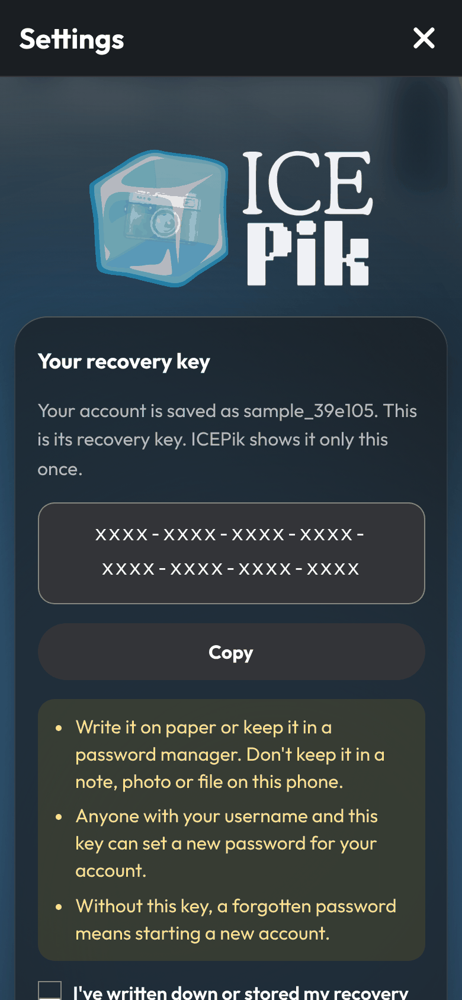
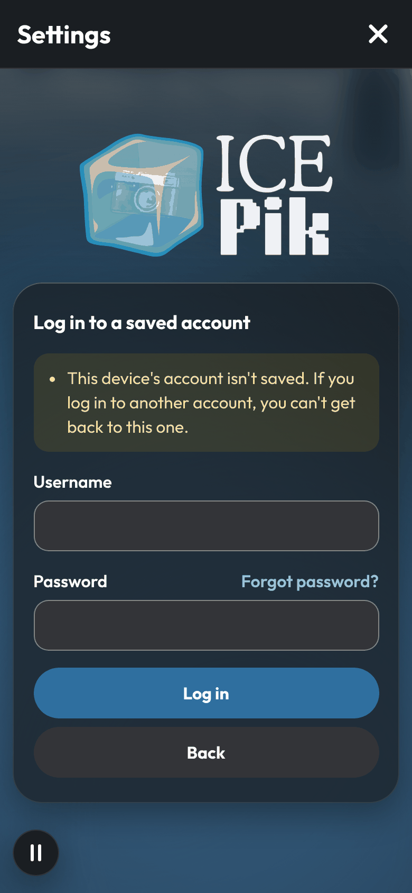
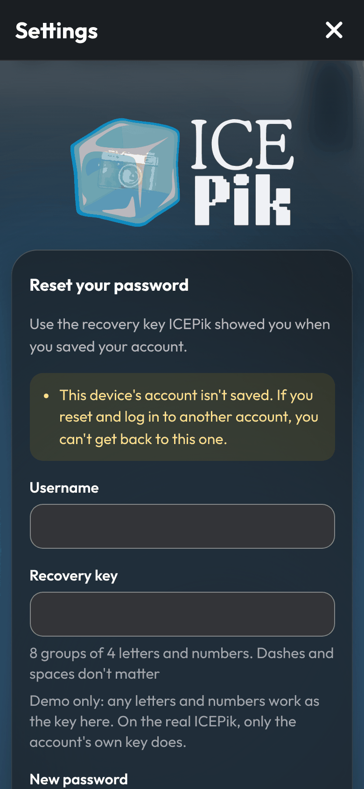
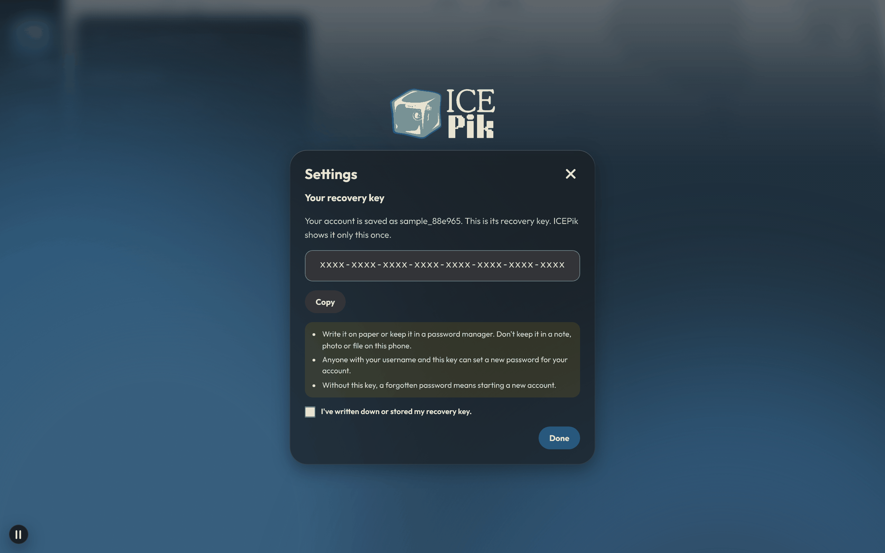
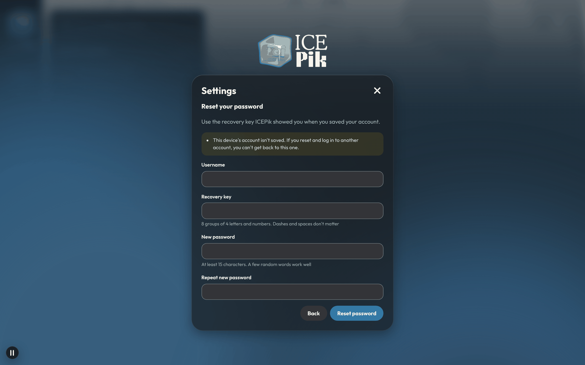

# Account recovery: screenshots

Each recovery screen at the seven sizes the layout checks use, in light mode (the account screens look the same in dark mode: they sit on the lava lamp). Taken on 22 November 2026 from a production build against the local stand-in for Supabase (`scripts/mock-supabase.mjs`), at device scale factor 2, with the same browser for every picture. Map tiles are real. The usernames are made up for the pictures, and **every recovery key is replaced by `xxxx-xxxx-…`** before the picture is taken: no real or test key appears here. The lava lamp is shown at the first frame of its animation, and each picture waits for notices such as "Account saved" to close. To keep the folder smaller, every image was saved with at most 192 colours (error-diffusion dithering, no visible banding); all stay at 2x.

The layout check (`node scripts/capture-layout.mjs --compare`) reports no existing element moved by more than 1 px.

| Screen | Desktop 1280×800 | Tablet 820×1180 | Tablet 768×1024 | Tablet on its side 1024×768 | Phone 390×844 | Short phone 360×667 | Phone on its side 844×390 |
|---|---|---|---|---|---|---|---|
| Save account (the warning now says a recovery key comes next) | [image](save-account-desktop.png) | [image](save-account-tablet.png) | [image](save-account-tablet-768.png) | [image](save-account-tablet-landscape.png) | [image](save-account-phone.png) | [image](save-account-phone-short.png) | [image](save-account-phone-landscape.png) |
| Your recovery key, after saving | [image](recovery-key-desktop.png) | [image](recovery-key-tablet.png) | [image](recovery-key-tablet-768.png) | [image](recovery-key-tablet-landscape.png) | [image](recovery-key-phone.png) | [image](recovery-key-phone-short.png) | [image](recovery-key-phone-landscape.png) |
| Settings, with the Recovery key section | [image](settings-recovery-key-desktop.png) | [image](settings-recovery-key-tablet.png) | [image](settings-recovery-key-tablet-768.png) | [image](settings-recovery-key-tablet-landscape.png) | [image](settings-recovery-key-phone.png) | [image](settings-recovery-key-phone-short.png) | [image](settings-recovery-key-phone-landscape.png) |
| Make a new recovery key | [image](make-new-key-desktop.png) | [image](make-new-key-tablet.png) | [image](make-new-key-tablet-768.png) | [image](make-new-key-tablet-landscape.png) | [image](make-new-key-phone.png) | [image](make-new-key-phone-short.png) | [image](make-new-key-phone-landscape.png) |
| Log in, with "Forgot password?" | [image](log-in-desktop.png) | [image](log-in-tablet.png) | [image](log-in-tablet-768.png) | [image](log-in-tablet-landscape.png) | [image](log-in-phone.png) | [image](log-in-phone-short.png) | [image](log-in-phone-landscape.png) |
| Reset your password | [image](forgot-password-desktop.png) | [image](forgot-password-tablet.png) | [image](forgot-password-tablet-768.png) | [image](forgot-password-tablet-landscape.png) | [image](forgot-password-phone.png) | [image](forgot-password-phone-short.png) | [image](forgot-password-phone-landscape.png) |
| Reset your password on `/demo`, with the demo note | [image](forgot-password-demo-desktop.png) | [image](forgot-password-demo-tablet.png) | [image](forgot-password-demo-tablet-768.png) | [image](forgot-password-demo-tablet-landscape.png) | [image](forgot-password-demo-phone.png) | [image](forgot-password-demo-phone-short.png) | [image](forgot-password-demo-phone-landscape.png) |
| Your new recovery key, after a reset | [image](key-after-reset-desktop.png) | [image](key-after-reset-tablet.png) | [image](key-after-reset-tablet-768.png) | [image](key-after-reset-tablet-landscape.png) | [image](key-after-reset-phone.png) | [image](key-after-reset-phone-short.png) | [image](key-after-reset-phone-landscape.png) |
| Make a recovery key, after logging in to an account without one | [image](make-a-key-after-login-desktop.png) | [image](make-a-key-after-login-tablet.png) | [image](make-a-key-after-login-tablet-768.png) | [image](make-a-key-after-login-tablet-landscape.png) | [image](make-a-key-after-login-phone.png) | [image](make-a-key-after-login-phone-short.png) | [image](make-a-key-after-login-phone-landscape.png) |

On short screens each picture is scrolled to what the screen is about (the key, "Forgot password?", the demo note), as a person would scroll.

## Phone

## Desktop

